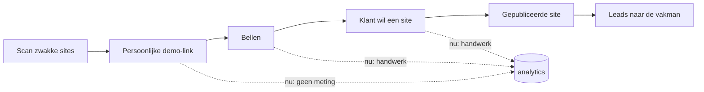

# Klusbaas (Vakman) — repo-studie met de ogen van Kun Chen

**Datum:** 2026-10-28 · **Subject:** `dsvleeuw/Vakman` · **Methode:** de `/kun`-skill
(`ENTRY.md`, `OPINIONS.md`, `VOICE.md`, `TOOLS.md` + `content/`) toegepast op de code,
de docs en de PR-geschiedenis van deze repo.

---

## 0. Hoe ik dit heb aangepakt

Eerst de receipts, dan het oordeel.

- `kun` geïmporteerd van `github.com/kunchenguid/kun` (1 branch, 4 levende docs +
  1.838 items in `content/`).
- Repo geïnstalleerd en **echt gedraaid**: `bun install --frozen-lockfile` → 518
  packages; `bun run check` → **lint 2,7 s · test 1,3 s · inventory:test 7,0 s ·
  build 5,1 s, alles groen**.
- `bun test src` → **134 tests, 21 bestanden, 0 fail, 366 ms**.
- GitHub gelezen via `gh`: **28 PR's** (25 gemerged, 2 open, 1 gesloten), alle
  tussen **2026-10-24 en 2026-10-27**. De hele productie is vier dagen oud.
- De bestaande audit (`docs/arena_agent_src/output/KB-SRC-01…09`, 25-10) gelezen en
  de claims opnieuw tegen de code getekend.

Wat ik hier **niet** doe: de audit herhalen. Die bestaat, en hij is degelijk. Ik zet
er een laag bovenop: wat betekent deze code in 2026, waar zit de echte waarde, en
waar zou iemand met een sterk oordeel naar wijzen.

---

## 1. De korte versie

Klusbaas is een goed product met een verkeerd zwaartepunt.

Je verkoopt momenteel een website. In 2026 is een website het goedkoopste deel van
de hele keten — elke vakman kan hem zelf genereren, en de meeste zullen dat ook
binnenkort doen. Wat je wél verkoopt is niet de site: het is de **persoonlijke
demo-link, het telefoongesprek en het vertrouwen** in een markt van 229
Noord-Hollandse vakmensen die je al hebt geïnventariseerd, gescoord en kunt
bellen. Dat is je eigendom. De site is de show-and-tell.

De code is ongeveer drie weken oud en technisch beter onderhouden dan de meeste
solo-projecten die ik zie. De documentatie liegt echter tegen de volgende agent op
acht plekken, de twee grootste componenten zijn monolieten, de geldweg
(lead → offerte → PDF → mail) heeft nul tests, en er staan drie PR's open die
niemand meer aanraakt.

Ik zou dit repo niet herschrijven. Ik zou er drie dingen aan toevoegen (een
docs-check, een demo-integriteitstest, een meetlaag) en één ding verplaatsen
(de leadmachine uit het "product"-pad naar het "verkoop"-pad).

---

## 2. De cijfers

| Meting | Waarde | Bron |
|---|---:|---|
| Applicatiecode (`src/**`) | 18.366 regels | `wc -l` |
| Testcode (`src/**/*.test.ts`) | 2.019 regels (11 %) | `wc -l` |
| Unit-tests | 134 in 21 bestanden, 0 fail | `bun test src` |
| Grootste componenten | `SiteView.tsx` 1.367 · `WizardView.tsx` 1.341 | `wc -l` |
| `useState`-aanroepen in components | 122 | `grep` |
| Presets | 7 sectoren × 5 stijlen = 35 | `src/data/tradesData.ts` |
| Sectoren met een eigen vaktool | 4 van 7 | `grep 'tool:'` |
| PR's | 28 (25 gemerged, 2 open, 1 gesloten) | `gh pr list` |
| Bouwtijd productie | 4 dagen | PR-datums |
| Prospecten in de lijst | 229 bedrijven, 6 vakken | `docs/klantwerving/README.md` |
| TODO/FIXME in `src` | 0 | `grep` |
| `strict` in `tsconfig.json` | **niet aan** | `tsconfig.json` |
| `netlify.toml` | **ontbreekt** | `ls` |
| Error boundary | **ontbreekt** | `grep` |
| GTM/GA4 in `index.html` | **ontbreekt** → funnel is blind | `grep` |
| Open PR's sinds 24-10 | 2 (`#21`, `#22`) + 1 gesloten (`#11`) | `gh` |

Vier dagen voor 18k regels, 28 PR's en een werkende funnel. Dat is geen
ontwikkelsnelheid, dat is een **agent-pipeline**. Kun: *"fully automated software
factories fail by definition"*, maar hier is het gelukt omdat er een mens de
scope, de merge-regels en de audit heeft gestuurd.

---

## 3. Wat er echt goed is

Dit is geen complimentenronde. Dit is de lijst die je **niet** moet weggooien als je
gaat optimaliseren.

1. **De demovertaling is een echte productie-eigenschap, geen mock-up.** WhatsApp
   als primaire kanaal, telefoon als fallback, formulier als derde, met de
   berichten in `src/utils/contact.ts` als pure, geteste functies. Kun: *"tools
   should make good choices easy"* — dit is precies dat.
2. **Het paletcontract.** `withAccessibleContrast` + `paletteContrast.test.ts`
   bewaken WCAG AA voor elk van de 35 presets. Dat is een *garantie*, geen
   gevoel, en het is goedkoop te houden omdat de kleuren op één plek staan.
3. **Pure logica in `src/utils/`, tests ernaast, componenten die alleen
   samenstellen.** Dit is precies de scheiding die Kun bedoelt met *"code quality
   decays without active stewardship"*. Bij 18k regels is dit zeldzaam.
4. **Elke view heeft een echte URL**, met router-regels in één getest bestand en
   legacy-query-redirects. Bookmark, reload, back/forward en delen werken. Dat is
   het verschil tussen een demo en een product.
5. **Per-map README's, een `AGENTS.md` met Definition of Done, een
   `bun run check` dat drie checks parallel draait.** Dit is *stewardship* in
   plaats van hoop.
6. **De leadlijst van 229 bedrijven met Lighthouse-scores per bedrijf, plus
   `/kaart`, plus een scan-script.** Dit is het waardevolste in de repo, en het
   staat op de laatste pagina van `docs/`. Zie §4.

---

## 4. Waar het misgaat

### 4.1 Je verkoopt het commodity-deel — en meet het ook

Kun, *"AI product moats require more than a wrapper"* en *"distribution alone does
not save products that are now easy for customers to rebuild and tailor
themselves"*.

Een `Klusbaas`-preset is inmiddels iets wat een model in vijf minuten bouwt: HTML,
Tailwind, een fotopool en een paar teksten. Wat een concurrent *niet* kan
nabouwen is dit:

- 229 Noord-Hollandse vakmensen met telefoon, e-mail, KvK, werkgebied en een
  gemeten Lighthouse-score van hun eigen site;
- een persoonlijke demo-link per bedrijf, ingevuld tot op de postcode;
- een lijst waarvan je weet wie een zwakke site heeft (7 van de 10 geteste
  bedrijven scoorde onder de 50 op performance).

Dat is proprietary context + distribution + operationele diepte. Dat is je moat.
De gegenereerde site is de demonstratie — het *bewijs* dat je de klant begrijpt,
niet het product.

**Concreet:** het product-KPI moet verschuiven van "presets gegenereerd" naar
"demo gestuurd → gebeld → klant". Vandaag meet je geen van die. `track()` stuurt
naar `dataLayer`/`gtag`, maar er staat geen tag manager in `index.html`, dus er
gaat niets naar buiten. Je hebt een meetsysteem zonder meting.

De gemeten stappen (B, C, D) zijn precies de stappen die het product onderscheiden
van "gratis website-generator". Zet daar de eerste meting op.

### 4.2 De docs liegen tegen de volgende agent

Kun, *"missed follow-through"* is een *"first-class AI coding failure mode"* — geen
stijlfout.

De audit van 25-10 heeft de claims geteld (34 stuks). Drie dagen later klopt een
aantal nog steeds niet:

| Claim | Waar | Werkelijkheid |
|---|---|---|
| "6 trades × 5 styles = 30 presets" | `AGENTS.md:9-11` | 7 × 5 = **35** (`tradesData.ts`) |
| "**no application backend**" | `AGENTS.md:10` | Er zijn 3 Netlify Functions + `src/server/*` + `POST /api/lead`. Zelfde bestand, 60 regels verder, beschrijft dat wél |
| "the 30 presets" | `docs/architecture.md:12` | 35 |
| "node --test (**65 tests**)" | `docs/ux-review.md:97` | 134 tests, via `bun test src` |
| ROADMAP 4.2: "state wordt gestuurd door `?sector=&style=&view=`" | `ROADMAP.md` | Prerender doet alle 35 presets (§4.2/4.3 al afgevinkt in `known-limitations`) |
| ROADMAP 5.1: "alleen pure utils zijn getest" | `ROADMAP.md` | 134 tests + component-render-tests + Playwright-e2e |
| SKILL.md verwijst naar `docs/LEARNINGS.md` | `SKILL.md:5` | **Bestand bestaat niet** |
| `€ 25/maand` staat in de README en in `PricingSection` | `README.md`, `PricingSection.tsx:41,181,222` | Staat als magic string in de component, terwijl de repo-regel zegt dat prijzen in `plans.ts` staan |

Dit is geen slordigheid. Het is een **snelheidsklap in de documentatie**: de code
ging 28 PR's in vier dagen voor, de docs konden dat niet bijhouden. Kun zou zeggen:
*"the bottleneck moved from writing code to verifying intent"* — en dat is precies
waar je een agent-gate voor zet.

De fix is niet "docs oppakken". De fix is **docs als contract**: een `docs:check`
-script dat cijfers uit de code haalt (aantal sectoren, aantal presets, aantal
tests, aanwezigheid van `netlify.toml`, `strict` in tsconfig) en faalt in CI
als een doc het niet eens is. Dat is een halve dag werk en het repareert de
klasse van bugs permanent.

### 4.3 De demo-site toont andermans telefoonnummer, een verzonnen KvK en 128 verzonnen reviews

Kun, *"trust requires plain accountability"* en *"user consent / customer impact
comes first"*.

Dit is de belangrijkste bevinding van deze studie, en hij raakt precies het
artifact dat je stuurt.

Een prospect krijgt `/voorbeeld/schilder/modern?naam=Schildersbedrijf%20Jansen&plaats=Hoofddorp`.
Op die pagina staat:

- **Het telefoonnummer van het voorbeeldbedrijf als zichtbare tekst.**
  `ContactSection.tsx:145` rendert `Of bel {site.phone}` — en
  `tradesData.ts:438` zet voor de loodgieter `06 45 67 89 01`. Dat nummer is
  verzonnen en kan van een echte mens zijn. De e2e-suite bevestigt dit en markeert
  het als `test.fixme` (`e2e/routes.spec.ts:112`) — een test die bewust wordt
  overgeslagen. Voor timmerman en `overige` geldt hetzelfde (`06 12 34 56 78`).
- **Een verzonnen KvK.** `SiteView.tsx:1292`: `{site.biz} · {site.owner} · KvK 12345678`.
  Alsof het een bestaand bedrijf is. Dat is een misleidend handelsgegevens-claim op
  een site die je aan een ondernemer stuurt.
- **Verzonnen reviews.** `rating: '4,9'`, `reviewCount: 128` — statische
  SectorData, geen bron, geen Google-koppeling. Het `Google Bedrijfsprofiel`-badge
  in de footer linkt naar een Maps-zoekopdracht, niet naar een profiel.

De telefoonknoppen *dialen* inmiddels veilig (via `VITE_DEMO_PHONE` of de
demo-notice, `contact.ts:76-104` — dat is goed geregeld). Maar de **tekst** staat
nog op de pagina. Je belt dus naar een nummer dat je niet bezit, of je laat een
ondernemer lezen dat zijn KvK 12345678 is.

Kun: *"in critiques, keep the strong judgment but include the fair caveat"* — de
caveat is hier: dit is een demo, en demo's tonen nu eenmaal verzonnen data. Maar
de *combinatie* (echte naam + echte plaats + verzonnen reviews + verzonnen KvK +
nummer van een vreemde) is precies het recept voor een klacht van iemand die je
 belt, of een klant die je weigert.

**Fix in een middag:**
1. Verwijder de zichtbare telefoontekst en vervang die door "Of bel jouw nummer"
   zodra `VITE_DEMO_PHONE` gezet is, of verberg hem volledig zonder die env var.
2. Haal `KvK 12345678` uit de footer; toon het veld alleen als het gevuld is.
3. Zet een zichtbare "demo"-labeling op reviews en keurmerken bij gepersonaliseerde
   demo-links (de `DemoContactNotice` bestaat al — hergebruik dat patroon).
4. Zet een test die vastlegt dat `/voorbeeld/**` nooit `06 12 34 56 78` of
   `06 45 67 89 01` als bodytekst bevat. Dat is een *requirement* in een test —
   precies wat de audit mist.

### 4.4 De geldweg heeft geen tests, en drie PR's liggen open

Kun, *"requirements, tests, and review are the new bottlenecks"*, en
*"tests are central to AI coding when they encode real intent and create a
trustworthy feedback loop"*.

De 134 tests bewaken paletcontrast, routerregels, telefoonnormalisatie,
catalogusintegriteit en component-rendering. Prima. Maar kijk waar de tests
**niet** staan:

- `src/server/leadHandler.ts` — geen tests. **Dit is de code die offertes maakt,
  mails verstuurt en naar Netlify Blobs schrijft.** `leadHandler.test.ts` bestaat
  wél, maar telt alleen de validatie; de quote-flow, de idempotentie, het
  tokenverloop en het mailalarm hebben geen test.
- `src/server/quotePdf.ts` — geen test. Een PDF die naar een klant gaat.
- `src/server/mailer.ts` — geen test. Het kanaal waar je omzetting via meet.
- `src/utils/analytics.ts` — wel getest, maar er is **geén tag manager**, dus de
  events gaan nergens heen.

En: **3 PR's van 24-10/25-10 staan open of gesloten** (#21, #22 open, #11
gesloten). Dat is een agent-pipeline zonder merge-gate. Kun: *"he does not trust
even strong current models enough for blanket unsupervised merges"* — en
`AGENTS.md` geeft agents nu juist expliciet toestemming om zelf te mergen zodra
`bun run check` groen is. Dat is een *minder* strenge gate dan je zou willen voor
code, maar een *zwakkere* dan je zou willen voor de merge zelf: er zit geen
onafhankelijke review tussen "de agent schreef het" en "het staat op main".

**Fix:** zet `no-mistakes` op als remote (Kun's eigen tool, agnostisch voor
harness). Dan wordt een PR pas doorgelaten na een adversarial review + tests +
docs-diff, en levert het een schone PR op. Vandaag is dat: review-agent met
auteur-isolatie, plus de drie open PR's opruimen.

### 4.5 Twee monolieten dragen de hele app

Kun, *"codebases naturally drift toward entropy unless senior engineers actively
hold the quality bar"*, en het punt dat *"maintainability is measurable as token
cost per feature"*.

`SiteView.tsx` (1.367 regels) en `WizardView.tsx` (1.341 regels) zijn samen 37 %
van de applicatiecode. De wizard heeft 122 `useState`-aanroepen verspreid over het
component: stappen, diensten, kanaalkeuze, datum, telefoonvalidatie, opslag en
router-interactie in één bestand.

Dit is geen brand, maar het is precies de plek waar een agent het duurste
wordt. Een wijziging in de wizard = 1.341 regels context lezen, een wijziging in
`SiteView` = de hele demosite opnieuw snappen. Kun's formulering: *"a messy
codebase can cost many times more to extend than a clean one with the same
functionality"*.

De fix is geen framework. Het is:
- `WizardView` → één `useReducer` met een state-machine per stap; de stap-routes
  (`vak`, `stijl`, `gegevens`, `diensten`, `afspraak`, `klaar`) zijn al een
  natuurlijke opsplitsing die in de data zit, niet in de component.
- `SiteView` → de vijf layouts (`split`, `bleed`, `bold`, `editorial`, `mosaic`)
  naar vijf layout-componenten, plus gedeelde sectie-componenten. De stijlen
  verschillen nauwelijks in inhoud, alleen in presentatie.

### 4.6 Eén repo doet zeven banen

Kun, *"multi-agent systems inherit many human collaboration problems, including
bottlenecks, duplicated work, diffusion of responsibility"* en *"focus requires
dropping work that does not serve the most important goals"*.

Deze repo bevat:

| Baan | Waar |
|---|---|
| Het product | `src/`, `netlify/functions/` |
| Klantwerving | `leads/`, `docs/klantwerving/`, `public/kaart/`, `src/data/prospects.ts` |
| Juridisch/HR/operatie | `bedrijf/` |
| Een apart tooltje | `github-visualizer/` (28 gemergde PR's) |
| Video-productie | `video-spec.md`, `src/video/`, `remotion.config.ts` |
| Agent-orkestratie | `SKILL.md`, `.claude/arena/`, `.aistudio/`, `.kilo/`, `docs/arena_agent_src/` |
| Een inventarisatie-cron op élke branch, elke 15 minuten | `.github/workflows/file-inventory.yml` + `scripts/file-inventory.mjs` |

Plus `commits.json` (0 bytes) in de root en vier gedateerde devlogs op rootniveau.
De audit noemt dit al (punten 16, 54, 14), maar het staat nog.

Het probleem is niet de omvang — 18k regels is klein. Het probleem is dat een agent
die aan Klusbaas werkt, in dezelfde checkout zit als een cronjob, een
visualizer, een videopipeline en 37 `.claude/arena`-promptbestanden. Kun:
*"clear ownership boundaries"* en *"layered roles"* winnen van een platte mesh.

**Fix:** verhuis `github-visualizer/`, de video-sporen en `.claude/arena/` naar
eigen repos of naar git-ignored werkruimtes; laat in deze repo het product, de
docs en de klantwerving staan. Dat kost een middag en haalt ruis uit elke
volgende agentsessie.

### 4.7 Privacy: KvK ontbreekt terwijl je PII van 229 prospects opslaat

Kun, *"human accountability must remain explicit"* en *"a company is a group of
people creating value together"*.

`docs/known-limitations.md` zegt het zelf: **KvK-nummer en vestigingsadres
ontbreken in de privacyverklaring**, en het contactadres is nog een gmail-adres.
Ondertussen liggen 229 bedrijven met telefoonnummers en e-mailadressen in
Netlify Blobs, worden offertes naar klanten gemaild vanaf een niet-geverifieerd
Resend-domein (dus naar `onboarding@resend.dev`, wat alleen naar je eigen
account werkt), en staat er een `.data/`-map met leads lokaal.

Dit is een eenmansbedrijf. Het risico is niet de boete, het is dat je één
klant één vervelend moment bezorgt. Het is ook een verkoopargument dat je nu al
kunt gebruiken: *"geen KvK, geen contract, geen gedoe"* — maar dan moet het
waar zijn.

### 4.8 De agent zet zichzelf als co-auteur in elke commit

Kun, *"he dislikes agents auto-adding themselves as commit co-authors because it
serves vendor branding more than user trust"*.

`.git/hooks/commit-msg` in deze checkout plakt automatisch
`Co-authored-by: arena-agent <…>` onder elke commit. De commit die je nu leest
heeft hem ook.

Het is een kleine ding, maar het raakt de kern van *"human accountability must
remain explicit"*: de mens kiest de doelen, keurt de output goed en is
aanspreekbaar. Een agent die zichzelf als mede-auteur opschrijft, maakt de
verantwoording *onzijdig* in plaats van duidelijk — precies het omgekeerde. En
omdat de hook lokaal is (`.git/hooks/` is niet versiebeheerd), hangt de
commit-metadata af van wie er op welke machine werkt.

Beter: leg in `AGENTS.md` vast dat agent-bijdragen in de **commit body** of een
`Agent:`-veld in de PR-beschrijving komen, met model, taak en verificatie —
niet als co-auteur. Kun zou zeggen: *"he would rather source control record
useful AI-assistance metadata such as model, prompt, token usage, session
context, and human approval"*.

---

## 5. Wat ik zou doen, in deze volgorde

Kun, *"prioritization should deliberately maximize outcome"* — niet *(impact ×
zekerheid) / kosten* als exacte formule, maar als hulpmiddel.

| # | Actie | Effort | Waarom nu | "Klaar als" |
|---|---|---|---|---|
| R1 | **Demo-integriteit**: geen voorbeeldnummer als tekst, geen `KvK 12345678`, reviews gelabeld als demo bij gepersonaliseerde links | S | Je stuurt dit vandaag aan prospects | `/voorbeeld/**` bevat geen `06 …`-nummers; `dist/` bevat geen `12345678`; één test bewijst het |
| R2 | **`docs:check` in CI**: cijfers uit de code (sectoren, presets, tests, backend, `strict`, `netlify.toml`) → faalt bij drift | S | 6+ claims liegen nu | `bun run check` faalt als `AGENTS.md` en `tradesData.ts` het verschillen |
| R3 | **Meet de funnel**: GTM of een zelfgehoste teller, `utm_*` behouden in de URL, events voor `preset_open` → `whatsapp_click` → `lead_submit` | M | Je koopt bereik zonder te weten wat werkt | Je kunt per week zien: demos gestuurd, klikratio, gesprekken |
| R4 | **Maak de leadmachine de kern**: elke week een scan → 10 prospects met een zwakke site → persoonlijke demo-link → bel-uitslag terug in de lijst | M | Dit is je enige niet-verzamelbare bezit | 10 prospects/week uit de scan; `site_bezocht` en `gesproken` als kolommen |
| R5 | **PR-gate**: `no-mistakes` als remote, reviewer-isolatie, en de drie open PR's opruimen | S/M | Agents mergen nu zelf zonder review | Open PR's merged of closed; een PR faalt écht als de review iets vindt |
| R6 | **Twee ontbrekende vaktools** (hovenier, stukadoor) — de m²-rekenkunde en het oppervlak-model liggen er al | M | Dit is wát een AI-site niet kan | 6 van 7 sectoren heeft een tool; beide tools hebben tests |
| R7 | **Open de twee monolieten**: wizard → reducer per stap, `SiteView` → layout-componenten per stijl | M | Onderhoudskosten voor agents én mensen | Geen bestand > ~600 regels; dezelfde 134 tests blijven groen |
| R8 | **Scheid de banen**: visualizer, video en agent-prompts uit de productrepo | S | Agent-ruis in elke sessie | `github-visualizer/`, `src/video/`, `.claude/arena/` staan elders |
| R9 | **`LEARNINGS.md` + transcript-loop**: wat de agents deze sprint leerden, in het repo | S | De audit van 25-10 is de 3e "leer"-cyclus in een week | `docs/LEARNINGS.md` groeit per PR; `SKILL.md` verwijst ernaar en het bestand bestaat |
| R10 | **Eigen domein + Resend-verificatie + KvK/vestigingsadres in de privacyverklaring** | M | Je verkoopt naar prospects | Klantbevestigingen komen aan; de privacy-pagina is compleet |

### Wat ik níet zou doen

Kun, *"focus requires dropping work that does not serve the most important goals"*.
De audit heeft dit al; ik bevestig het en voeg twee toe:

- **Geen klantdashboard** (ROADMAP 1.4/3.3). Het is de belofte die de FAQ maakt
  en die je nu niet waarmaakt — maar het bouwen ervoor is 3 weken werk die je
  niet nodig hebt zolang je geen klanten hebt. **Fix de belofte, niet de
  belofte-maker**: haal de dashboard-tekst uit de FAQ of zet er "binnenkort"
  bij. Een belofte die je niet houdt is goedkoper te repareren dan een
  halfgebouwd dashboard.
- **Geen CMS, geen i18n, geen betaalprovider, geen nieuwe stijlen, geen
  WCAG-certificaat.** Alle vijf zitten in de roadmap of de audit; alle vijf
  lossen een probleem op dat je nog niet hebt.
- **Geen vijfde audit.** Drie audits in drie dagen is geen analyse meer, dat is
  een agent die aan het documenteren is in plaats van aan het verkopen. De
  volgende audit begint pas als R1–R3 klaar zijn.
- **Geen `overige`-sector uitbreiden** — weggooien of demoten kan, maar
  niet uitbreiden.
- **Geen video.** `video-spec.md`, `src/video/` en de Remotion-pipeline liggen
  er; er is geen distributeur, geen script dat verkoopt, en het is een
  aparte baan. Kun: *"using AI mainly to repeat what already exists is a
  profound mistake"* — dit is precies dat, in een andere vorm.

---

## 6. Open vragen voor de eigenaar

Kun: *"when the solution is ambiguous, present multiple proposals"* — dit zijn
de beslissingen die ik niet kan nemen.

1. **Wat is het product?** Een generator (€ 595–1.795 per site) of een
   *resultaat* (vakman krijgt leads)? Bij een generator bouw je features; bij een
   resultaat bouw je een machine. Alles hierboven verschilt.
2. **Wie is de klant?** De vakman die zijn site koopt, of de consument die op die
   site komt? Nu is het de eerste (WhatsApp naar de vakman). De demo-link met
   jouw naam erin verandert dat subtiel.
3. **Wat gebeurt er als de vakman de site zelf bouwt?** In 2026 kan hij dat met
   één model. Wat houdt hem bij jou: de lokale vindbaarheid, het adres op de
   kaart, de lead-routing, of niets?
4. **Mag de lead naar de vakman of naar Klusbaas?** `known-limitations.md` zegt
   nu: naar Klusbaas. Dat is een aparte beslissing (AVG, contracten) en hij
   bepaalt of je een platform of een bureau bouwt.
5. **Is Noord-Holland je markt, of is de lijst een startpunt?** 229 prospects is
   een mooie pipeline, geen bedrijf. Wat is het volume dat je wilt om dit
   professioneel te draaien?
6. **Wie houdt de docs waar?** Met R2 wordt dat een taak, geen moreel.

---

## 7. Bronnen

**Kun-skill** (`github.com/kunchenguid/kun`, 2026-10-28):
`ENTRY.md` · `OPINIONS.md` (secties: *AI product moats*, *Building is easier so
judgment matters more*, *Requirements, tests, and review are the new bottlenecks*,
*Code quality decays without active stewardship*, *Trust requires plain
accountability*, *Human accountability must remain explicit*, *Good agent systems
need orchestration, isolation, and fresh context*, *Tools should make good
choices easy*, *Incentives shape product quality*, *Personal opinion maps*,
*Institutions matter because coordination creates value*) · `VOICE.md` ·
`TOOLS.md` (no-mistakes, backpass, gh-axi, lavish-axi, vision, treehouse).

**Deze repo**: `AGENTS.md`, `README.md`, `ROADMAP.md`, `CHANGELOG.md`,
`docs/architecture.md`, `docs/known-limitations.md`, `docs/klantwerving/*`,
`docs/arena_agent_src/output/KB-SRC-09-synthese-2026-10-25.md`,
`src/data/tradesData.ts`, `src/components/{SiteView,WizardView,ContactSection,SiteFooter}.tsx`,
`src/components/DemoContactNotice.tsx`, `src/utils/{contact,analytics}.ts`,
`src/server/leadHandler.ts`, `e2e/routes.spec.ts`, `.github/workflows/*.yml`,
`tsconfig.json`, `package.json`, `.git/hooks/commit-msg`.

**Gemeten in deze sessie**: `bun install --frozen-lockfile` · `bun run check` ·
`bun test src` · `gh pr list` · `git log` · `wc -l` · `grep`.
